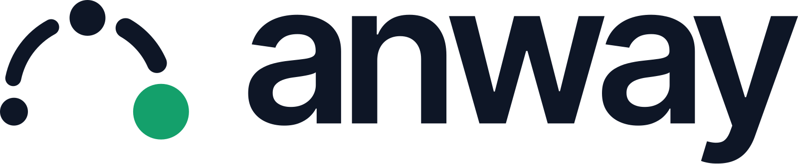
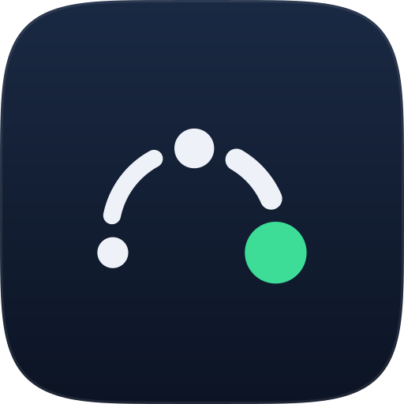

# Anway brand

<p>
  
</p>

This folder holds the Anway visual identity: the mark, the wordmark, the lockups, the app icons, and the colors. Use these files. Do not draw the mark again.

## The mark: Hop

<p>
  
</p>

A job leaves the app, waits in the queue, and lands on a worker. The mark draws that path as one arc with three stations: the app, the queue, and the job. The weight grows along the arc, and the path ends in the green job. Green means that the work is done.

### Construction

The mark is built on a 64 unit grid. `tools/build.py` calculates all values.

| Rule | Value |
|---|---|
| Circle | One circle with a radius of 19 units. All parts sit on it. |
| Stations | The queue is on the top. The app is at 166°, and the job is at the mirror angle, 14°. |
| Gap | 3 units between every pair of parts, along the circle. |
| Weight | App dot 3.5, first hop 4, queue dot 4.5, second hop 5, job dot 7. Dot values are radii, and hop values are stroke widths. |
| Position | The bounds of the mark are centered in the grid. |

### Small drawing

At 24 px and below, use the small drawing (`mark-small-*`, `favicon.svg`). It has heavier parts, longer hops, and less padding. Do not use the primary mark at these sizes, because its hops get thinner than 1 pixel.

| Rule | Primary | Small |
|---|---|---|
| Radius | 19 | 21 |
| App, queue, job dots | 3.5, 4.5, 7 | 4.5, 5.5, 8 |
| Hops | 4, 5 | 6, 6.5 |
| Gap | 3 | 3.5 |

## Wordmark

The wordmark is `anway` in lowercase, set in Inter Tight 600 with -0.04 em tracking. The files hold outlines, so they do not need the font.

## Lockups

| File | Use |
|---|---|
| `lockup-on-dark`, `lockup-on-light` | Default. Headers, websites, documents. |
| `lockup-stacked-on-dark`, `lockup-stacked-on-light` | Square spaces, title slides. |
| `lockup-clowk-on-dark`, `lockup-clowk-on-light` | Places that must name Clowk. |

In the horizontal lockup, the mark is 1.3 times the x-height of the wordmark, and its center is on the center of the x-height. The gap between the mark and the word is 0.55 x-heights.

In the stacked lockup, the mark is 2.6 x-heights tall, with 0.8 x-heights of space above the word.

### Clear space and minimum size

- Keep clear space around a lockup equal to the x-height of the wordmark. The lockup files are cut on the ink, so add this space when you place them.
- The 64 unit mark files have padding inside the grid. You can place them edge to edge.
- Minimum width of a horizontal lockup: 96 px on screen, 25 mm in print.
- Minimum size of the mark: 16 px, with the small drawing.

## App icons

| File | Use |
|---|---|
| `app-icon-navy` | Default app icon. |
| `app-icon-green` | Brand surfaces and marketing. |
| `app-icon-light` | Light pages. |
| `app-icon-square` | iOS, Android, and PWA. These platforms cut their own mask. The mark stays in the maskable safe zone. |

The squircle shape is a superellipse with power 5. It is not a rounded rectangle.

## Color

| Name | Value | Use |
|---|---|---|
| Navy | `#0E1626` | Main background. The mark on light backgrounds. |
| Ink | `#E7ECF5` | The mark and text on dark backgrounds. |
| Green | `#3DDC97` | The job dot on dark backgrounds. Success in the console. |
| Deep green | `#14A06B` | The job dot on light backgrounds. It has more contrast than Green on white. |

The job dot is always green, except in one-color files. Only the job dot is green.

## Do not

- Do not change the angles, the gaps, or the weights.
- Do not rotate, stretch, or outline the mark.
- Do not make the app dot, the queue dot, or the hops green.
- Do not add shadows, glows, or gradients to the mark. Only app icon tiles have a gradient.
- Do not set the wordmark in another font or with other tracking.
- Do not put the mark on a busy photo or pattern.

## Files

```
svg/   Source files. Use these when the platform accepts SVG.
png/   Rendered files for platforms that need PNG.
favicon.ico   16, 32, and 48 px, on a navy tile.
tools/   Scripts that build the files.
```

| Need | File |
|---|---|
| Website favicon | `svg/favicon.svg` (follows the light or dark browser theme), and `favicon.ico` as a fallback |
| Apple touch icon | `png/apple-touch-icon.png` (180 px) |
| PWA manifest | `png/icon-192.png`, `png/icon-512.png` (maskable) |
| GitHub social preview | `png/social-preview.png` (1280 by 640) |
| GitHub, npm, and RubyGems avatar | `png/app-icon-navy-512.png` |
| Console top bar | `svg/mark-small-on-dark.svg` at 24 px |

## Build

```bash
python3 brand/tools/build.py
brand/tools/render.sh
```

`build.py` uses only the Python standard library. `render.sh` needs `rsvg-convert` (librsvg) and `magick` (ImageMagick).

The wordmark outlines are in `tools/wordmark.json`. To change a text, run `tools/outline_wordmark.py` with the Inter Tight font. The script tells you how to install its two packages. Inter Tight is under the SIL Open Font License.
